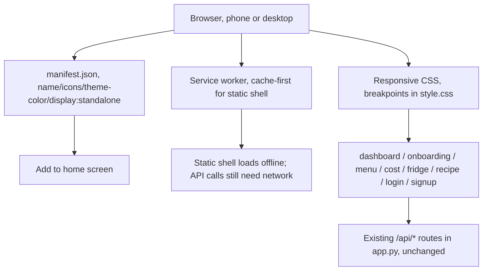

# Mobile support, picking a path

Every page today ships a `<meta viewport>` tag and nothing else mobile-specific. `style.css` has exactly one real responsive breakpoint (860px, collapses the sidebar into a top bar), no phone-width (480px-ish) tuning below that, and there's no `manifest.json` or service worker anywhere in the repo. Nobody had actually decided whether this becomes a responsive/installable web app or a separate native app. This doc is that decision, plus a sketch of what's buildable now versus later.

## The three paths, weighed honestly

**(a) Responsive-web pass, CSS only.** Fix the existing pages so they lay out correctly at phone widths. No new build tooling, no new runtime, just more `@media` rules on top of the one that already exists. Effort is small — this is a five-page app sharing one 921-line stylesheet, most of the layout is already flexbox/grid, so most of the work is tightening breakpoints on things like `.stat-row`, `.field-row`, `.goal-cards`, and `.week-grid` rather than rebuilding anything. Payoff is immediate: every page becomes usable on a phone browser today, no install step, no app store, works the moment someone opens the URL.

**(b) PWA on top of (a).** Add a `manifest.json` and a small service worker so the site can be added to a home screen and its static shell loads instantly (and partially offline) on repeat visits. Still the same Flask app, no new backend. This is a genuinely small addition on top of (a) — a JSON file, a cache-first service worker for static assets, two `<head>` lines per page — and it buys the one thing pure responsive CSS can't: something that behaves like an installed app (own icon, no browser chrome, splash screen) without touching a native SDK or an app store review process.

**(c) Native or cross-platform app (React Native/Flutter) against the existing Flask routes.** `webapp/app.py`'s `/api/*` routes are already a de facto JSON API — `/api/plan`, `/api/plan/adjust`, `/api/pantry`, `/api/recipe/<name>`, `/api/shopping-list` all take and return JSON already, cookie-session auth already exists via `auth.py`. So the backend work for this path is basically already done; what's missing is an entire second frontend codebase (screens, navigation, state management, a build/release pipeline, app store accounts) duplicating five pages that already exist as HTML+JS. For a solo project that's a large, ongoing maintenance cost — every future feature (the swipe survey, the plan-adjust NLU box, the fridge table) gets built twice, once in `webapp/static/js/*.js` and once in whatever the native app uses — in exchange for things this app doesn't currently need: true native APIs (camera-based barcode scanning is the one real candidate, see IDEAS.md's "Visual grocery input," but that's flagged there as future work, not something blocking today), offline-first behavior beyond what a service worker cache covers, or app-store distribution and discovery.

## The call

(b), a responsive-web pass plus a lightweight PWA layer, on top of (a) which it strictly requires anyway. Reasoning, not just a vibe:

- This project's own tone (IDEAS.md, AUTOMATION.md) is "buildable now, honest about what's out of scope." A second app codebase is not a small increment for one person, it's a standing maintenance commitment with no corresponding feature need yet.
- Nothing on the roadmap needs native APIs today. The one plausible future need, camera barcode scanning for grocery input (IDEAS.md), is itself explicitly sketched as future work, and browsers already expose barcode-capable camera access (`getUserMedia` + a JS decoder, or the emerging `BarcodeDetector` API) well enough to prototype inside a PWA before justifying a native rewrite.
- The backend is already API-shaped, so path (c) stays available later without any wasted work — nothing in (a)/(b) forecloses building a native client against the same `/api/*` routes if this app ever gets the users and the reason to justify one.
- A PWA gets most of what a native app's install/home-screen story provides (icon, standalone window, offline shell) for a cost measured in files, not weeks.

Revisit (c) if a specific native-only capability becomes a real requirement (camera scanning shipping for real, push notifications beyond what a PWA can do reliably on iOS, background sync) — not before.

## Architecture sketch

The service worker only ever caches the static shell (HTML/CSS/JS/icons). It does not, and shouldn't, cache `/api/*` responses — plan data, pantry state, and auth are all per-user and change on every mutation, caching them would mean stale macros or a stale pantry silently shown to the user. "Offline" here means "the app shell loads and shows a friendly state," not "full offline meal planning."

## What's buildable now

- Phone-width CSS pass across the shared `style.css`: tighten `.stat-row`, `.goal-cards`, `.field-row`, `.week-grid`, `.day-card`, `.swipe-actions`, modals, and tables below the existing 860px breakpoint, add a sub-600px tier for things that need to go fully single-column or shrink further (goal cards, stat tiles, the adjust-row input+button).
- `manifest.json` (name, short_name, icons, `display: "standalone"`, theme/background colors matching the existing `--accent`/`--surface-0` tokens) plus a minimal cache-first service worker for the static shell.
- `<link rel="manifest">` and `<meta name="theme-color">` wired into every page's `<head>`, plus a tiny shared script that registers the service worker.
- This lands on `dashboard.html` and `onboarding.html`, the only two pages that exist as files in this worktree as of this pass. `app.py` already routes `/menu`, `/cost`, `/fridge`, `/recipe/<name>`, `/login`, and `/signup` to HTML files of the same shape that don't exist yet (other concurrent work is building them). Because the responsive rules live in the one shared `style.css` and the PWA wiring is copy-paste per page (`<link rel="manifest">`, the theme-color meta tag, one script tag), whoever adds those pages next picks up both by following the same two-line pattern already sitting in `dashboard.html`/`onboarding.html` — nothing about this pass is dashboard/onboarding-specific.

## What's later, not now

- Testing on a real iOS/Android device rather than a desktop browser's responsive-mode emulation. Emulation catches layout bugs; it doesn't catch iOS Safari's PWA quirks (no push notifications, stricter storage eviction, the "Add to Home Screen" flow being manual rather than an install prompt).
- Any offline write support (queuing a pantry edit or a plan adjustment while offline and syncing later). The service worker here is read-only caching of static assets; making mutations offline-durable is a real feature (background sync, conflict resolution against the server's plan state) and not a small add-on.
- Push notifications for pantry expiry (see IDEAS.md's "Expiry notifications" section) — that needs a service worker with push-subscription handling plus a backend endpoint to send them, which is a bigger, separate piece of work than the installability-only service worker added here, and depends on the expiry-notification work already flagged as in progress elsewhere.
- A native app, per the "Revisit (c)" note above — only once there's a concrete native-only requirement, not as a default next step after the PWA.
