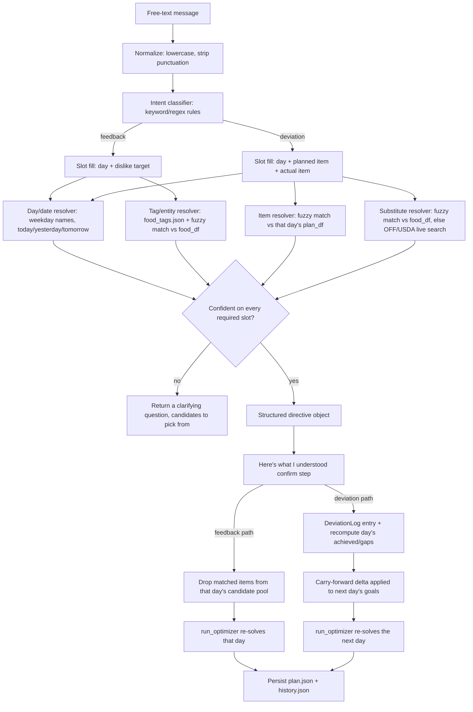

# Talking to the plan, a lightweight NLU layer for adjustments

Every menu generator built so far in this repo assumes the plan is right until the user opens the app and clicks something, replace-item, reshuffle, undo. That's real friction against how eating actually works. Life is spontaneous: a plan gets rejected for a reason worth understanding ("Thursday has beef right after Wednesday's beef"), and a plan gets deviated from without ever being rejected at all ("I skipped the grilled chicken bowl and got a burger instead"). This doc sketches a layer that takes a plain-English message about either of those and turns it into a real mutation of the saved plan, without an LLM in the loop.

Two capabilities, one shared pipeline underneath.

**Corrective feedback.** The user didn't like something about a specific day's plan. The system extracts what was disliked, drops it as a candidate for that day, and re-solves just that day the same way `/api/plan/replace-item` already does.

**Deviation logging.** The user already ate something different from what the plan said. The system figures out which planned item that replaces, prices and macros the actual item eaten, corrects that day's achieved totals, and carries any resulting shortfall or overage into the next day's targets before re-solving it.

## Why this doesn't need an LLM

The reason this is tractable without a paid model in the loop is the same reason the rest of this project is tractable at all: the vocabulary isn't open-domain. A user isn't free-associating about anything in the world, they're talking about a specific 7-day plan built from a closed, known set of items (`food_df`, `recipes.json`, the pantry), on specific days (today plus the next six), described with a small, predictable set of verbs (didn't like, don't want, avoid, instead, ended up, skipped, went out). That's a slot-filling problem, not a language-understanding problem, day, item, and disposition, extracted with keyword rules and fuzzy string matching against a database the system already has loaded. It'll misparse sentences a general LLM wouldn't, that trade is the entire point, this is meant to run as a few hundred lines of pure Python on every request at zero marginal cost, not call out to anything.

Worth being honest about the boundary rather than overselling it, same as IDEAS.md does elsewhere in this repo. This is a rule-based NLU, not a statistical or learned one. It will not understand phrasing it has no rule for. The design leans on that limitation rather than hiding it: **when a message can't be confidently resolved, the system asks a clarifying question instead of guessing.** Silently mis-editing someone's macro tracking on a bad parse is worse than not acting at all.

## Architecture sketch



The confirm step matters enough to call out on its own. AUTOMATION.md already established this project's trust principle for anything that acts on the user's behalf without being asked in the moment, nothing commits until confirmed. A misparsed message here doesn't spend money, but it does silently rewrite someone's tracked macros or drop a whole day's plan, so the same principle applies: show the parsed directive in plain language, let the user confirm or cancel, only then mutate anything.

## Capability 1: corrective feedback

Input: `"I didn't like Thursday's menu because it has beef right after Wednesday which also has beef"`.

The parser doesn't need to understand the causal clause, "because X follows Y" is context, not an actionable slot. What's actionable is just two things: **which day** (Thursday, resolved against the current plan's date range) and **what to avoid** (beef). Everything after "because" is discarded once those two slots are filled; a future version could use the adjacency reasoning to proactively flag repeats before the user complains (see Open questions below), but the reactive path doesn't depend on it.

"Beef" isn't a field this schema tracks directly, `FoodItem` has `category` and dietary booleans but nothing like a protein-source tag. That's the one new piece of data this capability needs: a small, hand-curated `food_tags.json`, the same curated-not-fabricated approach `recipes.json`/`ingredients.json` already use, mapping a handful of canonical tags to synonym substrings:

```json
{
  "beef": ["beef", "steak", "burger", "meatball", "brisket"],
  "chicken": ["chicken", "poultry"],
  "pork": ["pork", "bacon", "ham", "sausage"],
  "fish": ["salmon", "tuna", "tilapia", "fish"],
  "dairy": ["cheese", "milk", "yogurt", "cream"]
}
```

Resolving "beef" means matching those synonyms case-insensitively against each candidate's `name`/`category`/`notes`, the same fields already searchable today. The matched item names get excluded from that day's candidate pool exactly the way `/api/plan/replace-item` already excludes a single replaced item, then `run_optimizer` re-solves that one day with everything else pinned. No new solver logic, this reuses a pattern the codebase already has.

## Capability 2: deviation logging and macro reconciliation

Input: `"I didn't end up having the grilled chicken bowl for dinner, I went out and had a burger instead"`.

Two entities to resolve here, not one, the planned item that got skipped and the real item that replaced it, plus the day.

**Day resolution.** Same weekday/relative-date resolver as capability 1.

**Planned-item resolution.** Fuzzy match the named item ("grilled chicken bowl") against that day's actual `plan_df` names, not the whole food database, the search space is just whatever's already on that day's plan, so this should resolve confidently almost always. Worth flagging honestly: this repo's plan model doesn't track meal slots (breakfast/lunch/dinner) today, a day is just a list of items across channels, so "for dinner" in the message is a hint the parser can't actually act on. If the user names the item, that's enough. If they don't ("I skipped dinner"), the system can't guess which item on a multi-item day they mean, that's a clarification case, surface that day's items and ask which one.

**Actual-item resolution.** Try a fuzzy match against `food_df`/recipes first, since anything already in the curated database has known macros and a price. If nothing matches with real confidence, fall back to the live Open Food Facts / USDA FoodData Central search this repo already wired up for `/api/ingredients/search`, same modules, same pattern, just triggered from a parsed sentence instead of a search box. If that still comes back ambiguous (multiple plausible "burger" results with meaningfully different macros), return the top few candidates as a clarifying choice rather than picking one, per the no-guessing rule above.

**Recompute.** Once both items are known, that day's achieved macros become `achieved - planned_item.macros + actual_item.macros`, and `gaps` (the field `update.md` #4 already added) gets recomputed the same way the optimizer already computes it for a best-effort day. This is arithmetic on numbers the system already has, not a new computation.

**Carry-forward.** The interesting part. If the deviation pushed the day meaningfully over or under a macro target, that shouldn't just be swallowed silently, the next day's plan should account for it, the same way a real person adjusts, eat lighter tomorrow after a heavy dinner out. The rule is a capped, deterministic delta, not a model decision:

```
delta = actual_item.macros - planned_item.macros
next_day_goal[macro] = default_goal[macro] - clamp(delta[macro], -cap, cap)
```

`cap` bounds the adjustment to some fraction of the daily target (for example, no more than 20% of the daily calorie goal shifts in either direction), so one large deviation doesn't demand an unreasonable swing the next day, undershoot by 800 calories and the plan should nudge up, not try to claw back the entire deficit in 24 hours. `next_day.goals` on the existing `DayPlan` dataclass is exactly the hook this needs, `menu_planner.plan_week` already supports a per-day goals override, this just means computing that override from the deviation instead of leaving it `None`.

## New pieces this needs

- `src/macro_optimizer/nlu.py` — normalization, intent classification, and the day/item/tag slot resolvers. Pure functions over strings and the already-loaded `food_df`/`plan_df`, no I/O beyond what's passed in, easy to unit test against literal example sentences.
- `src/macro_optimizer/data/food_tags.json` — the hand-curated tag lexicon capability 1 needs, same trust posture as `recipes.json`, no fabricated data, extend it by hand as gaps show up.
- `src/macro_optimizer/deviation.py` — a `DeviationLog` class shaped like `PickHistory` (JSON-backed, `webapp/data/deviations.json`, gitignored the same way `pantry.json`/`history.json` are), plus the recompute and carry-forward functions.
- `src/macro_optimizer/adjustments.py` — the dispatcher that takes a parsed directive from `nlu.py` and calls into either the feedback-exclusion path (reusing `run_optimizer`/`menu_planner`) or the deviation path (`deviation.py` plus a next-day re-solve), and produces the plain-language "here's what I understood" confirmation text, template-based like `confirmation_digest()` already is, not LLM-phrased.
- `POST /api/plan/adjust` in `webapp/app.py` — body `{"message": "..."}`. Returns either `{"status": "needs_clarification", "question": "...", "options": [...]}` or `{"status": "confirm", "directive": {...}, "preview": "..."}` first; a second call with `{"message": "...", "confirmed": true}` (or a re-posted directive) actually commits the mutation and returns the updated day(s) in the same shape `/api/plan/replace-item` already returns.
- A small text-entry widget on the dashboard or menu page (new `webapp/static/js/adjust.js`, or folded into `dashboard.js`) that posts to `/api/plan/adjust`, renders the confirm/clarify step, and re-renders the affected day(s) on commit.

## Open questions worth flagging rather than resolving here

Whether "beef right after beef" should become a **proactive** guard, the optimizer refusing back-to-back repeats of the same tag on its own, rather than only reacting after a complaint, the way `rotation_cap`/`recency_penalty` already discourage repeating the exact same item. That's a natural extension once `food_tags.json` exists for the reactive path, but it changes the objective function, not just the candidate pool, so it's a separate, bigger change worth its own design pass rather than bundling into this one.

Whether the carry-forward cap should be a fixed percentage or itself learned from how often the user tends to deviate, this repo's existing stance (see IDEAS.md's "Learning preferences from history") is that anything learned needs real usage history to learn from first, so a fixed cap is the honest starting point, not a placeholder for something smarter later without saying so.

## Known limitation: the feedback path barely understands any food (found 2026-08-28)

Built and wired up per the sketch above, then tried by hand, not just against unit tests, and it's weak in a way that matters: type `"I dont want apples, can you take them out of todays meals"` and the system answers `"What food would you like to avoid?"` with exactly five options, `beef`, `chicken`, `dairy`, `fish`, `pork`. Apple isn't a protein source, so of course it isn't on that list, but the user just said the word "apples" in plain English and got treated as if they'd said nothing parseable at all.

**Root cause.** `classify_intent` and `resolve_day` both worked correctly on that message, "dont want" matched the `"don't want"` feedback trigger and "today" resolved to the right day. The failure is narrower than it looks: `extract_tag` (`src/macro_optimizer/nlu.py:94`) only ever checks the free text against `food_tags.json`'s five hand-curated categories, `beef`/`chicken`/`pork`/`fish`/`dairy`, all protein sources by design (see "Capability 1" above), because that's literally the only example this doc ever sketched out. There is no fallback to matching the disliked word against the actual plan or catalog by name. Contrast this with the deviation path's `extract_item_match`, which fuzzy-matches free text against real item names via `SequenceMatcher` and has no such blind spot, it would have found "Apple" in about a tenth of a second. The feedback path never calls it. Any food that isn't one of those five words, any fruit, vegetable, grain, snack, condiment, cuisine, or specific dish by name, produces a clarifying question whose own options list is drawn from the same five-entry file, so the "help" it offers doesn't even cover the gap.

This isn't a rare edge case in a long tail of phrasing, it's the common case. The five-tag lexicon was always going to be too small to be the *only* way to name a disliked food; it was designed as a way to generalize a complaint ("beef" catching "steak", "burger", "brisket") on top of literal matching, not as a replacement for literal matching. That second half never got built.

**Fix options, roughly cheapest to most powerful:**

1. **Give the feedback path the fallback it's missing.** When `extract_tag` comes back empty, don't go straight to "what food would you like to avoid," first try `extract_item_match` (already exists, already tested) against that day's actual plan item names, the same way the deviation path already does. "Apples" against a day that includes "Apple" resolves instantly, no new infrastructure, no new file to hand-maintain. This turns feedback resolution into "curated tag first (generalizes to synonyms), literal fuzzy match second (covers everything already on the plan)," and only asks the user to clarify when *both* miss. This is a small, mechanical change, an afternoon, not a redesign, and it's the obvious next step before reaching for anything heavier.
2. **Grow `food_tags.json`.** Straightforward and still worth doing alongside (1), more categories (fruit, dairy alternatives, grains, sweets, cuisines) means more complaints generalize past the single literal item mentioned ("I'm sick of citrus" should drop oranges *and* grapefruit). But this is curation work with no natural end point, and it doesn't fix the underlying gap, it only ever covers what someone remembered to add, which is exactly the failure that got reported here.
3. **A small trained classifier/slot-tagger** (e.g. spaCy's NER retrained on food-item examples, or a lightweight sklearn intent+slot model) instead of hand-written keyword rules. More robust to phrasing this project's author didn't anticipate, but it needs labeled training examples this project doesn't have yet, and it trades "read the code to know exactly why it did what it did" for "read a confusion matrix," a real cost in a codebase whose whole design philosophy up to now (see "Why this doesn't need an LLM" above) has been deterministic, testable, zero-marginal-cost parsing.
4. **A small local language model (SLM)** in the loop, something like Phi-3-mini or Qwen2.5-0.5B-1.5B run locally via `llama.cpp`/Ollama, prompted to extract `{intent, day, item_or_tag}` as structured JSON. This is the most capable option by a wide margin, it would have understood "apples" *and* phrasing nobody's thought to test for yet, and it directly answers what was asked here. It's also a real architectural reversal, not a tweak: it adds a runtime dependency and a model file (hundreds of MB to a few GB) that has to be installed and run alongside Flask, it adds real per-request latency where today's parse is sub-millisecond, it adds a new failure mode (malformed JSON out of the model) on top of the existing "couldn't parse" one, and it quietly drops the "runs as pure Python at zero marginal cost" property this whole document opened by defending. None of that makes it the wrong call, an SLM this small is cheap to run locally and easy to keep fully offline, but it's worth choosing deliberately rather than backing into, since option 1 alone would have silently fixed the exact complaint that got filed today.

**Recommendation, if asked rather than deciding unilaterally:** do (1) immediately, it's small, low-risk, and directly closes the reported gap; do (2) opportunistically as more foods come up; treat (3) and (4) as a real fork to make on purpose later, once it's clear whether the remaining failures are "the tag list is still too small" (favors (2)/(3)) or "phrasing rules can't keep up with how people actually type" (favors (4)).
