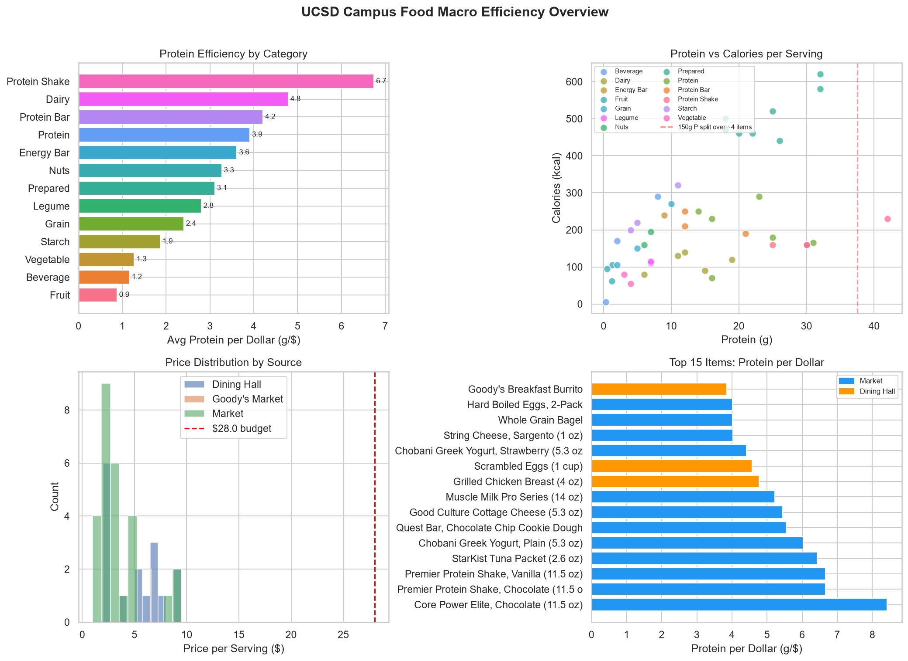

# UCSD Macro Optimizer

A constrained optimization tool that finds the cheapest combination of on campus food that hits a set of daily nutrition targets, calories, protein, carbs, and fat, within a UCSD dining dollar budget.

## What it does

The notebook models grocery and dining hall choices as an integer linear program (PuLP/CBC). Given a set of macro goals and a daily budget, it picks the combination of servings that minimizes total spend while meeting every macro floor. If no combination can meet every goal within budget, it falls back to a soft constraint version that gets as close as possible and reports which goals to relax.

## Data sources

- A curated database of items sold at UCSD's campus markets (Goody's, Sixth Market, Seventh Market, Sunshine Market)
- A curated database of UCSD HDH dining hall a la carte items
- A live scraper that pulls current nutrition facts from UCSD's public dining portal

## Data accuracy

The market item prices and macros in this notebook are hand entered estimates from the 2024-25 school year, not official data, and they are known to be inaccurate in places. I'm currently in contact with UCSD Housing, Dining and Hospitality to get real inventory and pricing data for Goody's, Sixth Market, Seventh Market, and Sunshine Market. Once that data comes through, it will replace the curated estimates so results reflect what's actually on the shelves.

## Setup

```bash
pip install -r requirements.txt
pip install -e .
jupyter notebook ucsd_macro_optimizer.ipynb
```

## Web app

A small Flask front end sits on top of the same package, `webapp/app.py`. It's a two-page flow, not a notebook: an onboarding form (sex, age, height, weight, activity level, goal, daily budget, cook time, dietary preferences) that computes your macro targets and posts them to `/api/plan`, and a dashboard that renders the result, today's suggested meals, a full week's menu chosen freely across every fulfillment channel built so far (cook at home, prepared meal delivery, restaurant order), and a meal analysis section with macro-vs-goal meters, budget utilization, and a channel cost breakdown.

```bash
pip install -r requirements.txt
pip install -e .
python webapp/app.py
```

Then open `http://localhost:5000`. `profile.py` is what turns the onboarding form into a goals dict: Mifflin-St Jeor for BMR, the standard activity multipliers for maintenance calories, then a goal-based calorie shift (±500/±300 kcal) and a protein target scaled to bodyweight, fat and carbs split the remainder. It's a standard estimate, not a medical calculation, same caveat as any macro calculator. Every plan a session builds is stateless and recomputed fresh, there's no account system or saved history across visits yet.

## Project structure

The optimization engine, food schema, and databases live in a real package under `src/macro_optimizer/` now, not just inline in the notebook. The notebook imports from it.

```
src/macro_optimizer/
    schema.py      # FoodItem, the shared shape every candidate row is normalized into
    database.py     # load_food_db(), apply_dietary_filters()
    optimizer.py     # run_optimizer(), soft-constraint fallback, anti-repetition guard, time budget
    profile.py         # compute_goals(): height/weight/activity/goal -> a macro goals dict
    recipes.py           # the recipe layer: ingredients -> priced per-serving candidate
    pantry.py               # inventory offset, so owned ingredients reduce a recipe's cost
    history.py                 # pick history, feeds the anti-repetition guard
    menu_planner.py               # plan_week(): one meal combination per day against a time budget
    channels.py                     # ChannelAdapter interface: Cook at Home, Prepared Meal Delivery, Restaurant Order
    orchestrator.py                   # plan_week_multichannel(): the decision engine, plus a confirm-before-purchase digest
    openfoodfacts.py                    # live grocery/packaged-goods lookup against Open Food Facts, no API key needed
    usda_fdc.py                           # live generic-ingredient lookup against USDA FoodData Central
    data/                                   # market_items.json, dining_items.json, ingredients.json, recipes.json,
                                              #   prepared_meals.json, restaurant_orders.json (illustrative, see below)
webapp/
    app.py           # Flask routes + the /api/plan endpoint
    static/            # onboarding.html, dashboard.html, css/, js/ (vanilla, no build step)
tests/                    # pytest coverage for all of the above, including the Flask API
```

Run the tests with:

```bash
pytest
```

### Recipe & pantry layer

IDEAS.md sketches a recipe layer, buy raw ingredients and assemble them into a meal, which usually beats eating out on macros per dollar, plus pantry awareness so a recipe's real cost is only what you still need to buy. Both are implemented: `recipes.py` decomposes a recipe into a per-serving cost and macro row using `data/ingredients.json`, `pantry.py` tracks owned quantities and offsets cost (not macros) against them, and the result plugs into `run_optimizer` as one more candidate item, no changes to the solver needed. `history.py` adds the anti-repetition guard IDEAS.md calls for: a pure cost-minimizing ILP has no reason to ever vary its answer, so a recency penalty and a rotation cap keep it from settling into the same handful of items every run. See notebook section 14 for a worked example.

### Menu planner

IDEAS.md's menu planner extends single-day planning into an actual week, aware of how much free time each day has to cook and able to pin a specific recipe to a specific day. `schema.py` carries `prep_minutes`/`cook_minutes` on every candidate now (0 for anything ready to eat), `run_optimizer` gained an optional `time_budget_minutes` constraint plus `preference_bonus` (soft nudge toward a liked item) and `pinned_items` (hard-include, the "manually preferred recipes" IDEAS.md calls the simplest piece to build), and `menu_planner.plan_week()` solves one day at a time in order, feeding each day's picks back into the same `PickHistory` before solving the next, so the anti-repetition guard works across the whole week, not just across separate runs. The calendar side stays a plain per-day minute budget, IDEAS.md flags real Google Calendar integration as a separate, not-free integration for later, not something to half-build here. Preference *learning* from usage history is intentionally not implemented either, per IDEAS.md that needs an app used over time to log real picks against, not a single notebook run. See notebook section 15 for a worked example.

### Multi-channel automation

AUTOMATION.md's core idea is that a meal slot shouldn't be locked to one fulfillment path, the system should freely choose whichever channel is cheapest and easiest that day. `channels.py` wraps each path in a common `ChannelAdapter` interface: `CookAtHomeAdapter` is real, the same market/dining/recipe database everything else here uses; `PreparedMealAdapter` and `RestaurantOrderAdapter` are small illustrative catalogs (`data/prepared_meals.json`, `data/restaurant_orders.json`, every row tagged `confidence: "illustrative_example"`) standing in for a real Trifecta- or DoorDash-style vendor integration this project doesn't have API access to build, **not real menu or pricing data from any vendor**. `orchestrator.plan_week_multichannel()` is the decision engine: each day it keeps only the channels that have already cleared their lead time (a prepared meal needs 3 days' notice, so it drops out of the near-term days on a rolling weekly plan while same-day channels stay open), unions those channels' candidates, and hands the union to the same `run_optimizer`, no new solver logic needed. `orchestrator.confirmation_digest()` is the confirm-before-purchase step AUTOMATION.md calls for, a plain-text, nothing-happens-until-approved summary. **No code here places a real order or spends real money**, that needs the vendor integrations flagged above. See notebook section 16 for a worked example.

### Live grocery data lookup

IDEAS.md ranks "grocery and packaged goods" as one of the two data-layer tiers that are mostly covered already by existing structured databases, and names two sources for it: Open Food Facts and USDA FoodData Central. Both are implemented, live, as the same normalization pattern aimed at complementary slices of the data.

`openfoodfacts.py` builds the Open Food Facts side, a free, crowdsourced nutrition database that needs no API key or account at all, strongest on branded packaged goods. `lookup_and_price()` looks a product up live, by barcode or free-text search, and normalizes it into the same `FoodItem` shape as everything else here, filtering out crowdsourced entries that have no real name or are missing macro data rather than blindly taking the first hit. Note that its free-text search runs on a legacy endpoint that returns occasional 503s under load; `lookup_by_barcode` hits the current API and has been reliable in testing, prefer it when a barcode is known. See notebook section 17.

`usda_fdc.py` builds the USDA FoodData Central side, restricted to its Foundation and SR Legacy data types, lab-analyzed, government-sourced macros for generic raw ingredients (chicken breast, rolled oats), the same kind of thing `recipes.py`'s hand-typed `data/ingredients.json` currently estimates by hand. Unlike Open Food Facts this needs an API key, but getting one is free and instant at [api.data.gov/signup](https://api.data.gov/signup), no business relationship required; without one it falls back to the public `DEMO_KEY`, which works with no signup but is rate-limited hard (30 requests/hour, shared across everyone using the default). Set the `USDA_FDC_API_KEY` environment variable once you have your own. See notebook section 18.

Both modules share the same real gap, per IDEAS.md's own analysis: these are nutrition databases, not pricing ones, so every lookup needs a caller-supplied price, same as pricing any grocery item by hand. Every row either module produces is tagged `confidence="external_api"` so it stays distinguishable from the hand-curated database.

## Notebook sections

1. Configuration. Set your own macro goals, budget, and dietary filters.
2. Food database. Market items, dining hall items, and the live scraper.
3. Combined food dataframe.
4. Exploratory analysis.
5. Optimization engine.
6. Run the optimization.
7. Optimal daily meal plan.
8. Results visualization.
9. Comparison against a current diet.
10. Dietary restriction analysis (vegetarian, vegan, halal, gluten free, no pork).
11. Budget sweep sensitivity analysis.
12. Achievable goal targets for a fixed budget.
13. Add or update food items.
14. Recipe & pantry layer, priced recipes with pantry offset and the anti-repetition guard.
15. Weekly menu planner, time-budgeted, pinnable, and history-aware across days.
16. Multi-channel automation, lead-time-aware channel selection and a confirm-before-purchase digest.
17. Live grocery data lookup, a real Open Food Facts query normalized into the same food schema.
18. USDA ingredient data lookup, a real FoodData Central query for lab-analyzed generic ingredient macros.
19. Summary and recommendations.

## Beyond UCSD

This notebook is scoped to one campus, but the same idea works anywhere, macros and location in, an optimized plan across restaurants, corner stores, and grocery stores out. [IDEAS.md](IDEAS.md) sketches what that would take and flags the parts that are still an open problem. Anyone who wants to pick up a piece of it is welcome to.

## The bigger picture

This repo is the software core of a larger personal project, automating food decision-making, procurement, and eventually preparation, with near-zero daily attention from the user. [VISION.md](VISION.md) documents that broader scope: the twelve-month plan, system architecture, hardware considerations, and the moral implications of building it. Everything in this repo today, the notebook, the package, and the web app, is that project's planner layer, the piece the vision doc calls the one to build first.

## Preview



Claude was used in the development of this project.
